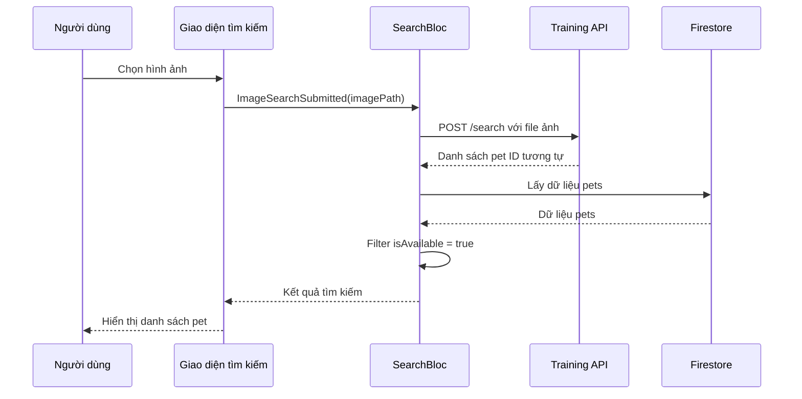
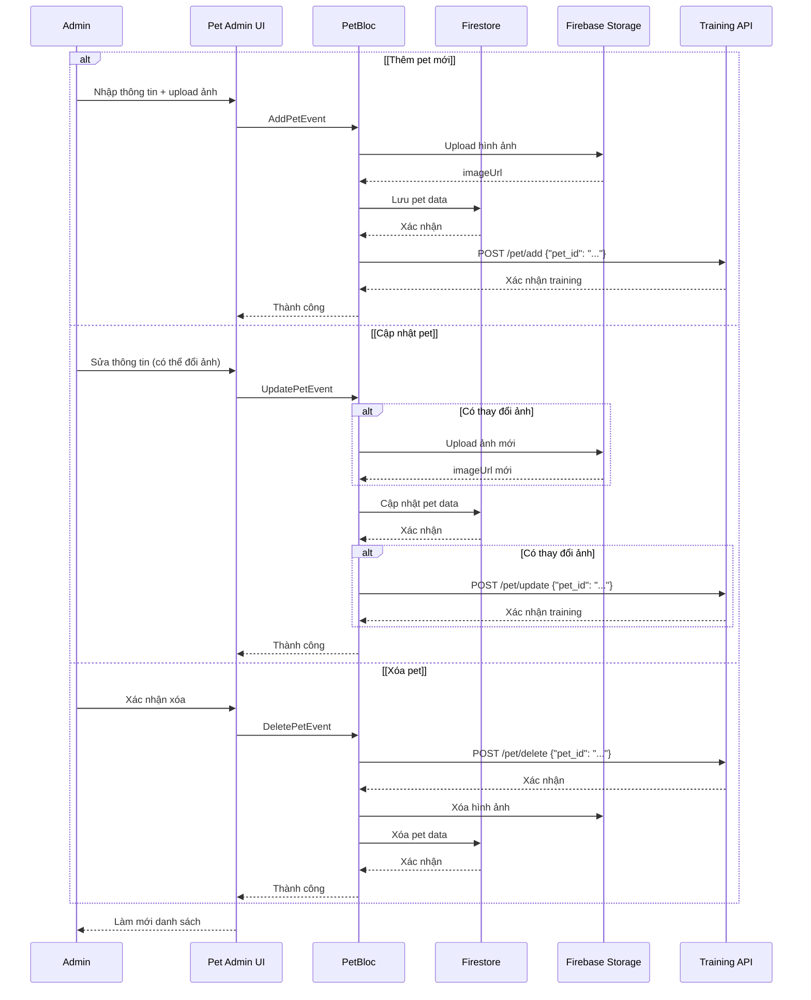

# Tích hợp API Tìm kiếm và Training Hình ảnh Pet

## 📋 Tổng quan

Hệ thống đã được tích hợp với API AI để:
1. **Tìm kiếm pet bằng hình ảnh** - Sử dụng AI để tìm pet tương tự
2. **Training tự động** - Cập nhật model khi admin thêm/sửa/xóa pet

---

## 🔗 API Endpoints

**Base URL**: `https://trainimagepet-api.onrender.com`

### 1. Tìm kiếm bằng hình ảnh
```bash
POST /search
Content-Type: multipart/form-data

# Ví dụ:
curl -X POST https://trainimagepet-api.onrender.com/search \
  -F "file=@pet_image.jpg"

# Response:
{
  "similar_images": [
    {
      "image_path": "uploads/pet123.jpg",
      "similarity": 0.95
    }
  ]
}
```

### 2. Thêm pet vào training
```bash
POST /pet/add
Content-Type: application/json

# Ví dụ:
curl -X POST https://trainimagepet-api.onrender.com/pet/add \
  -H "Content-Type: application/json" \
  -d '{"pet_id": "abc123"}'

# Response: 200 OK
```

### 3. Cập nhật pet trong training
```bash
POST /pet/update
Content-Type: application/json

# Ví dụ:
curl -X POST https://trainimagepet-api.onrender.com/pet/update \
  -H "Content-Type: application/json" \
  -d '{"pet_id": "abc123"}'

# Response: 200 OK
```

### 4. Xóa pet khỏi training
```bash
POST /pet/delete
Content-Type: application/json

# Ví dụ:
curl -X POST https://trainimagepet-api.onrender.com/pet/delete \
  -H "Content-Type: application/json" \
  -d '{"pet_id": "abc123"}'

# Response: 200 OK
```

### 5. Train toàn bộ model (Manual)
```bash
POST /train

# Ví dụ:
curl -X POST https://trainimagepet-api.onrender.com/train

# Response: 200 OK
```

---

## 🎯 Luồng hoạt động

### 📱 User: Tìm kiếm bằng hình ảnh



**Điều kiện filter kết quả:**
- ✅ `isAvailable = true` (hoặc null/undefined → mặc định true)
- ✅ `status != 'sold'`
- ✅ Hình ảnh khớp với kết quả từ API

### 🛠️ Admin: Quản lý Pet



---

## 📂 Code Implementation

### 1. Search BLoC - Image Search Handler

**File**: `lib/presentation/bloc/search/search_bloc.dart`

```dart
Future<void> _onImageSearchSubmitted(
  ImageSearchSubmitted event,
  Emitter<SearchState> emit,
) async {
  emit(SearchLoading());
  
  try {
    // Gọi API search
    final uri = Uri.parse('https://trainimagepet-api.onrender.com/search');
    var request = http.MultipartRequest('POST', uri);
    request.files.add(await http.MultipartFile.fromPath('file', imagePath));
    
    var response = await request.send();
    
    if (response.statusCode == 200) {
      final data = jsonDecode(await response.stream.bytesToString());
      
      // Lấy danh sách file names
      List<String> fileNames = (data['similar_images'] as List)
          .map((img) => path.basename(img['image_path'] as String))
          .toList();
      
      // Query Firestore
      final allPets = await _firestore.collection('Pets').get();
      
      // Filter: match image + isAvailable
      final results = allPets.docs.where((doc) {
        final data = doc.data();
        final imageUrl = data['imageUrl'] as String? ?? '';
        final matchesImage = fileNames.any((fn) => imageUrl.contains(fn));
        
        // isAvailable: null/undefined = true (mặc định)
        final isAvailable = data['isAvailable'] is bool 
            ? (data['isAvailable'] as bool) 
            : true;
        
        final status = data['status']?.toString().toLowerCase() ?? '';
        final isNotSold = status != 'sold';
        
        return matchesImage && isAvailable && isNotSold;
      }).map((doc) {
        final data = doc.data();
        data['id'] = doc.id;
        return data;
      }).toList();
      
      emit(SearchSuccess(searchResults: results, ...));
    }
  } catch (e) {
    emit(SearchError('Lỗi tìm kiếm: $e'));
  }
}
```

### 2. Pet BLoC - Training API Calls

**File**: `lib/presentation/pages/web/screen_admin/pet/bloc/pet_bloc.dart`

```dart
// Thêm pet
Future<void> _onAddPet(AddPetEvent event, Emitter<PetState> emit) async {
  emit(PetActionInProgress('Đang thêm thú cưng...'));
  
  // Upload image + Save to Firestore
  final imageUrl = await _uploadImage(imageBytes, pet.id);
  await _petsCollection.doc(pet.id).set({...});
  
  // Gọi API training
  await _callPetAddAPI(pet.id);
  
  emit(PetActionSuccess('Thêm thành công!'));
}

// Cập nhật pet
Future<void> _onUpdatePet(UpdatePetEvent event, Emitter<PetState> emit) async {
  bool imageChanged = false;
  
  // Upload new image if provided
  if (event.imageBytes != null) {
    finalImageUrl = await _uploadImage(imageBytes, pet.id);
    imageChanged = true;
  }
  
  // Update Firestore
  await _petsCollection.doc(pet.id).update({...});
  
  // Chỉ gọi API nếu có thay đổi ảnh
  if (imageChanged) {
    await _callPetUpdateAPI(pet.id);
  }
  
  emit(PetActionSuccess('Cập nhật thành công!'));
}

// Xóa pet
Future<void> _onDeletePet(DeletePetEvent event, Emitter<PetState> emit) async {
  // Gọi API trước
  await _callPetDeleteAPI(event.petId);
  
  // Xóa image + Firestore
  await imageRef.delete();
  await _petsCollection.doc(event.petId).delete();
  
  emit(PetActionSuccess('Xóa thành công!'));
}

// Helper methods
Future<void> _callPetAddAPI(String petId) async {
  final uri = Uri.parse('https://trainimagepet-api.onrender.com/pet/add');
  final response = await http.post(
    uri,
    headers: {'Content-Type': 'application/json'},
    body: jsonEncode({'pet_id': petId}),
  );
  debugPrint('✅ Pet $petId đã được thêm vào training model');
}

Future<void> _callPetUpdateAPI(String petId) async {
  final uri = Uri.parse('https://trainimagepet-api.onrender.com/pet/update');
  final response = await http.post(
    uri,
    headers: {'Content-Type': 'application/json'},
    body: jsonEncode({'pet_id': petId}),
  );
  debugPrint('✅ Pet $petId đã được cập nhật trong training model');
}

Future<void> _callPetDeleteAPI(String petId) async {
  final uri = Uri.parse('https://trainimagepet-api.onrender.com/pet/delete');
  final response = await http.post(
    uri,
    headers: {'Content-Type': 'application/json'},
    body: jsonEncode({'pet_id': petId}),
  );
  debugPrint('✅ Pet $petId đã được xóa khỏi training model');
}
```

---

## ✅ Checklist Testing

### Tìm kiếm bằng hình ảnh
- [ ] Upload ảnh pet từ gallery
- [ ] Kiểm tra loading state
- [ ] Kết quả chỉ hiển thị pets có `isAvailable = true`
- [ ] Pets với `status = 'sold'` không xuất hiện
- [ ] Pets với `isAvailable = null` vẫn hiển thị (mặc định true)
- [ ] UI hiển thị số lượng kết quả chính xác
- [ ] Tap vào kết quả chuyển đến detail page

### Admin Add Pet
- [ ] Upload ảnh mới
- [ ] Điền đầy đủ thông tin
- [ ] Submit thành công
- [ ] API `/pet/add` được gọi với đúng `pet_id`
- [ ] Console log: "✅ Pet xxx đã được thêm vào training model"
- [ ] Danh sách pets tự động refresh
- [ ] Pet mới xuất hiện trong search results

### Admin Update Pet
- [ ] Chỉnh sửa thông tin không đổi ảnh → API **KHÔNG** được gọi
- [ ] Chỉnh sửa thông tin + đổi ảnh → API `/pet/update` được gọi
- [ ] Console log: "✅ Pet xxx đã được cập nhật trong training model"
- [ ] Tìm kiếm bằng ảnh mới trả về pet đã update

### Admin Delete Pet
- [ ] Xác nhận xóa
- [ ] API `/pet/delete` được gọi trước khi xóa Firestore
- [ ] Console log: "✅ Pet xxx đã được xóa khỏi training model"
- [ ] Pet biến mất khỏi danh sách
- [ ] Tìm kiếm bằng ảnh không còn trả về pet đã xóa

---

## 🔧 Troubleshooting

### Lỗi thường gặp

**1. API timeout hoặc không phản hồi**
```
Error: TimeoutException after 30 seconds
```
→ Server API có thể bị sleep (Render free tier). Thử gọi lại sau vài giây.

**2. Filter isAvailable không hoạt động**
```dart
// ❌ SAI:
final isAvailable = item['isAvailable'] ?? true;

// ✅ ĐÚNG:
final isAvailable = item['isAvailable'] is bool 
    ? (item['isAvailable'] as bool) 
    : true;
```

**3. API training không được gọi**
- Kiểm tra console logs: "✅ Pet xxx đã được..."
- Kiểm tra network tab trong DevTools
- Verify headers: `Content-Type: application/json`

**4. Tìm kiếm trả về pets đã sold**
- Kiểm tra filter logic trong `_onImageSearchSubmitted`
- Verify field `status` trong Firestore
- Thêm log: `print('Pet status: $status, isAvailable: $isAvailable')`

---

## 📊 Performance Notes

- **API Search**: ~2-5s (tùy kích thước ảnh)
- **API Training**: 
  - `/pet/add`: ~500ms (chỉ train 1 ảnh)
  - `/pet/update`: ~500ms
  - `/pet/delete`: ~200ms
  - `/train` (full): ~30s-2 phút (train toàn bộ)

**Optimization:**
- API calls chạy async, không block UI
- Loading dialog hiển thị trong khi processing
- Error handling để tránh crash nếu API fail

---

## 🔐 Security

- ✅ Chỉ Admin mới có quyền trigger training APIs
- ✅ User search không cần authentication
- ✅ Filter `isAvailable` đảm bảo privacy (pets không public sẽ không hiện)
- ⚠️ TODO: Rate limiting cho search API (tránh abuse)

---

## 📝 Migration Notes

**Thay đổi từ version cũ:**

| Cũ | Mới | Lý do |
|-----|-----|-------|
| `train-pet-image.onrender.com` | `trainimagepet-api.onrender.com` | URL mới chính thức |
| `/train` (toàn bộ) | `/pet/add`, `/pet/update`, `/pet/delete` | Tối ưu - chỉ train pet thay đổi |
| Filter sau khi search | Filter trong query | Performance tốt hơn |
| `isAvailable ?? true` | Kiểm tra type trước | An toàn với dữ liệu không đồng nhất |

---

## 🎓 Tài liệu tham khảo

- [Firebase Storage](https://firebase.google.com/docs/storage)
- [HTTP Package](https://pub.dev/packages/http)
- [BLoC Pattern](https://bloclibrary.dev/)
- [Multipart Upload](https://pub.dev/documentation/http/latest/http/MultipartRequest-class.html)
