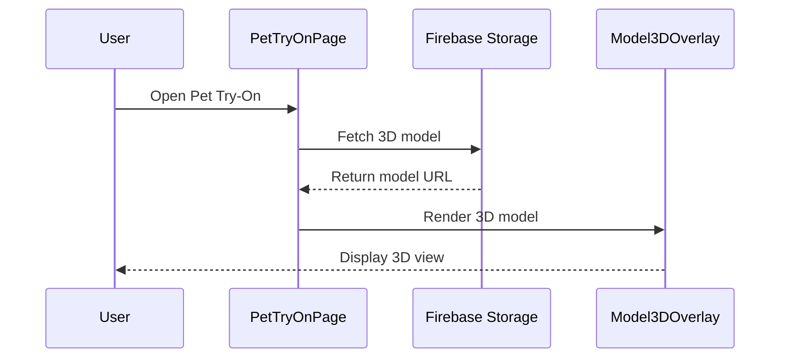

# TÀI LIỆU MÔ TẢ CHỨC NĂNG MỚI VÀ ĐỀ XUẤT SƠ ĐỒ

## Ngày tạo: 25/11/2025

---

## MỤC LỤC
1. [Chức năng Thử Thú Cưng 2D/3D (Pet Try-On)](#1-chức-năng-thử-thú-cưng-2d3d-pet-try-on)
2. [Chức năng Quét Mã QR Thú Cưng](#2-chức-năng-quét-mã-qr-thú-cưng)
3. [Mạng Xã Hội Thú Cưng (Social Network)](#3-mạng-xã-hội-thú-cưng-social-network)
4. [Quản Trị Mạng Xã Hội (Admin Social Management)](#4-quản-trị-mạng-xã-hội-admin-social-management)
5. [Tổng Kết Sơ Đồ Cần Vẽ](#5-tổng-kết-sơ-đồ-cần-vẽ)

---

## 1. CHỨC NĂNG THỬ THÚ CƯNG 2D/3D (PET TRY-ON)

### 1.1. Mô Tả Chung
Chức năng cho phép người dùng "thử" xem thú cưng trông như thế nào trong môi trường thực của họ thông qua camera trực tiếp hoặc ảnh đã chụp, hỗ trợ cả chế độ hình ảnh 2D và mô hình 3D có thể xoay 360 độ.

### 1.2. Luồng Hoạt Động Chi Tiết

#### A. Khởi Động Trang Pet Try-On
1. **Người dùng mở trang Pet Try-On từ trang chi tiết thú cưng**
   - Nhấn nút "Thử trong phòng" (icon AR) ở góc trên AppBar
   - Truyền dữ liệu thú cưng vào PetTryOnPage

2. **Hệ thống khởi tạo**
   - Xác định loại thú cưng (Dog/Cat/Fish/Bird) từ dữ liệu pet['type'] hoặc pet['category']
   - Thiết lập trọng lượng mặc định dựa trên category (Dog: 10kg, Cat: 4kg, Fish: 0.5kg, Bird: 0.3kg)
   - Tự động khởi tạo camera sau (back camera)
   - Tải hình ảnh/mô hình 3D từ Firebase Storage theo folder:
     - 2D: `3d_model/Dogs`, `3d_model/Cats`, `3d_model/Fish`, `3d_model/Birds`
     - 3D: `3d_model/Dogs_3D`, `3d_model/Cats_3D`, `3d_model/Fish_3D`, `3d_model/Birds_3D`

#### B. Chế Độ Camera (Live Camera vs Photo)
1. **Live Camera Mode (Mặc định)**
   - Hiển thị CameraPreview thời gian thực
   - Người dùng có thể di chuyển điện thoại để thấy thú cưng trong môi trường khác nhau
   - Tối ưu: Tự động dispose camera khi app vào background để tránh crash

2. **Photo Mode (Chụp ảnh phòng)**
   - Người dùng nhấn "Capture Photo"
   - Mở ImagePicker với source: camera
   - Chụp ảnh phòng/môi trường cố định
   - Dispose camera và chuyển sang hiển thị ảnh tĩnh
   - Người dùng có thể "Retake Photo" để chụp lại

#### C. Chuyển Đổi Chế Độ 2D/3D
1. **Chế Độ 2D (Image Mode)**
   - Hiển thị hình ảnh PNG từ Firebase Storage
   - Dùng CustomPainter để vẽ hình ảnh lên canvas
   - Hỗ trợ: Di chuyển (1 ngón), Phóng to/Thu nhỏ (2 ngón pinch), Xoay (2 ngón rotate)
   - Cache hình ảnh trong memory để tối ưu hiệu suất

2. **Chế Độ 3D (Model Viewer Mode)**
   - Hiển thị mô hình .glb hoặc .gltf từ Firebase Storage
   - Dùng package `model_viewer_plus` với WebView rendering
   - Hỗ trợ: 
     - Di chuyển widget (1 ngón)
     - Phóng to/thu nhỏ widget (2 ngón pinch)
     - Xoay mô hình 3D 360° (ModelViewer cameraControls - tự động xử lý bởi WebView)
   - AR Mode: Hỗ trợ AR trên iOS/Android (cần file .usdz cho iOS, .glb cho Android)

3. **Toggle 2D/3D**
   - Người dùng nhấn SegmentedButton để chuyển đổi
   - Khi chuyển sang 3D: Hiển thị loading dialog trong 500ms để tải mô hình
   - Giữ nguyên vị trí (offset) và scale khi chuyển đổi

#### D. Tùy Chỉnh Thú Cưng
1. **Chọn Category**
   - 4 category: Dog, Cat, Fish, Bird
   - Mỗi category có icon và màu riêng
   - Khi đổi category:
     - Tự động tải hình ảnh/mô hình mới từ Firebase Storage
     - Reset trọng lượng về default của category đó
     - Hiển thị loading indicator trong khi tải

2. **Điều Chỉnh Kích Thước (Weight-Based Sizing)**
   - Slider để chọn trọng lượng trong phạm vi của từng category
   - Công thức tính scale: `scale = 0.3 + (normalized_weight * 0.9)`
   - normalized_weight = (current - min) / (max - min)
   - Phạm vi:
     - Dog: 1kg - 50kg
     - Cat: 1kg - 10kg  
     - Fish: 0.1kg - 5kg
     - Bird: 0.05kg - 2kg
   - Cập nhật real-time khi kéo slider

3. **Flip Controls**
   - Flip Horizontal: Lật ngang hình ảnh (scaleX = -1)
   - Flip Vertical: Lật dọc hình ảnh (scaleY = -1)
   - Áp dụng cả 2D và 3D mode

#### E. Gesture Controls (Điều Khiển Cử Chỉ)
1. **1 Ngón Tay (Single Finger)**
   - Kéo để di chuyển vị trí widget (offset)
   - Áp dụng cho cả 2D và 3D

2. **2 Ngón Tay (Two Fingers)**
   - Pinch (véo): Phóng to/thu nhỏ widget (scale từ 0.05 đến 5.0)
   - Rotate (xoay): Chỉ áp dụng cho 2D mode (rotation)
   - 3D mode: ModelViewer tự xử lý xoay mô hình bên trong qua cameraControls

3. **Giới Hạn Vùng (Bounds)**
   - Tính toán để giữ widget trong màn hình
   - margin = 20px
   - Clamp offset theo kích thước canvas

#### F. Chụp Ảnh và Chia Sẻ
1. **Capture Screenshot**
   - Nhấn nút download icon trên AppBar
   - Hiển thị warning dialog cho 3D mode (giới hạn kỹ thuật WebView)
   - Dùng RepaintBoundary để chụp widget tree
   - pixelRatio: 4.0 cho 3D, 3.0 cho 2D (chất lượng cao)
   - Đợi 500ms cho 3D mode để WebView render xong

2. **Lưu và Chia Sẻ**
   - Convert UI widget sang PNG bytes
   - Lưu vào thư viện ảnh dùng package `gal` (album: "PetTryOn")
   - Hiển thị thông báo thành công với tên file
   - Mở Share Sheet để người dùng chia sẻ

#### G. Collapse/Expand Controls
- Nút thu gọn/mở rộng bảng điều khiển
- Tiết kiệm không gian màn hình khi thử thú cưng
- AnimatedContainer với duration 300ms

#### H. Xử Lý Lifecycle và Crash Prevention
1. **App Lifecycle**
   - Pause camera khi app vào background (AppLifecycleState.inactive)
   - Reinitialize camera khi app quay lại (AppLifecycleState.resumed)
   - Dispose camera safely khi thoát trang

2. **Error Handling**
   - Catch camera initialization errors
   - Hiển thị error message cho người dùng
   - Fallback options khi không có camera

### 1.3. Công Nghệ Sử Dụng
- **Camera**: `camera` package (version 0.11.2+1)
- **3D Rendering**: `model_viewer_plus` package (version 1.7.1) - WebView-based
- **Image Picker**: `image_picker` package
- **Saving Images**: `gal` package (version 2.3.0)
- **Sharing**: `share_plus` package
- **Storage**: Firebase Storage (hình ảnh PNG và mô hình .glb/.gltf)
- **State Management**: StatefulWidget với setState

### 1.4. Đề Xuất Vẽ Sơ Đồ

#### ✅ **SƠ ĐỒ TUẦN TỰ 1: Luồng Khởi Tạo và Tải Mô Hình 3D**
**Lý do cần vẽ**: 
- Luồng phức tạp với nhiều bước: khởi tạo camera → xác định category → tải từ Firebase Storage → render 3D
- Có xử lý bất đồng bộ (async) và error handling
- Tương tác giữa nhiều component: UI, Camera, Firebase Storage, ModelViewer

**Các actor/component**:
- User
- PetTryOnPage (UI)
- CameraController
- Firebase Storage
- Model3DOverlay (WebView)

**Luồng chính**:
1. User mở Pet Try-On từ Detail Pet
2. System khởi tạo camera
3. System xác định category từ pet data
4. System fetch 3D model từ Firebase Storage
5. System render model với ModelViewer
6. User thao tác (move, scale, rotate)

#### ✅ **SƠ ĐỒ HOẠT ĐỘNG 1: Capture và Share Screenshot**
**Lý do cần vẽ**: 
- Quy trình có nhiều điều kiện (2D vs 3D, success vs error)
- Có xử lý đặc biệt cho 3D mode (warning dialog, delay rendering)
- Nhiều bước tuần tự: capture → convert → save → share

**Các bước chính**:
1. User nhấn nút capture
2. [Decision] Kiểm tra 3D mode?
   - Nếu 3D: Hiển thị warning dialog
   - User có thể cancel hoặc continue
3. [Decision] User confirm?
   - Nếu cancel: Kết thúc
   - Nếu continue: Tiếp tục
4. Hiển thị loading dialog
5. [3D only] Đợi 500ms cho WebView render
6. Capture widget với RepaintBoundary
7. Convert sang PNG bytes
8. Save vào gallery (Gal package)
9. Hiển thị success message
10. Mở Share Sheet
11. Hide loading dialog

---

## 2. CHỨC NĂNG QUÉT MÃ QR THÚ CƯNG

### 2.1. Mô Tả Chung
Chức năng cho phép quét mã QR để nhanh chóng truy cập thông tin chi tiết của thú cưng. Admin có thể tạo và in mã QR, người dùng có thể quét để xem thông tin.

### 2.2. Luồng Hoạt Động Chi Tiết

#### A. Tạo Mã QR (Admin)
1. **Admin mở trang quản lý thú cưng**
   - Truy cập Web Admin Panel → Pets Management
   - Chọn một thú cưng để xem chi tiết

2. **Hệ thống tự động tạo QR Code**
   - Component: `PetQrCodeSection` trong `pet_qr_code_section.dart`
   - Sử dụng package `qr_flutter` version 4.1.0
   - URL format: `https://adopt-pet-d1c88.web.app/home/pet/{petId}`
   - Hiển thị QR code ngay trong card

3. **In QR Code**
   - **In đơn lẻ**: Admin nhấn "Print QR Code"
     - Tạo PDF với QR code và thông tin thú cưng (tên, ID)
     - Mở Print Dialog của hệ thống
     - Sử dụng package `printing` version 5.13.2
   
   - **In hàng loạt**: Admin nhấn "Print Batch QR Codes"
     - Chọn nhiều thú cưng từ danh sách
     - Tạo PDF với nhiều QR code (mỗi trang 4-6 QR)
     - Layout tối ưu cho cắt và dán lên chuồng/tag

#### B. Quét Mã QR (User)
1. **Người dùng mở QR Scanner**
   - Truy cập từ Home → Menu → Scan QR Code
   - Hoặc từ nút nổi trên thanh navigation
   - Mở trang `QRScannerScreen`

2. **Yêu cầu quyền Camera**
   - Kiểm tra và xin quyền camera
   - Nếu bị từ chối: Hiển thị hướng dẫn cấp quyền trong Settings

3. **Quét QR Code**
   - Hiển thị camera preview toàn màn hình
   - Overlay với khung quét 300x300px (màu trắng, viền 3px)
   - Instruction text: "Đưa mã QR vào khung để quét"
   - Control buttons:
     - Flash On/Off
     - Switch Camera (front/back)

4. **Phát hiện và Xử lý QR Code**
   - Sử dụng package `mobile_scanner` version 6.0.11
   - Hỗ trợ nhiều format QR:
     - **Format mới**: `https://adopt-pet-d1c88.web.app/home/pet/123` (parse segment [0]='home', [1]='pet', [2]='123')
     - **Format cũ**: `https://happypet.com/pet/123` (parse segment với index của 'pet')
     - **Text format**: `PET:123` (substring sau "PET:")
     - **Plain ID**: `123` (dùng trực tiếp)

5. **Validate và Query Firestore**
   - Hiển thị loading dialog: "Đang quét thú cưng..."
   - Validate petId không empty
   - Query Firestore collection `Pets` với doc ID = petId
   - Xử lý kết quả:
     - **Nếu tìm thấy**: 
       - Hide loading dialog
       - Lấy dữ liệu thú cưng
       - Navigate to DetailPet page với pet data
     - **Nếu không tìm thấy**:
       - Hide loading dialog
       - Hiển thị error dialog: "Không tìm thấy thú cưng"

6. **Prevent Rapid Scanning**
   - Set flag `_isProcessing = true` khi bắt đầu xử lý
   - Delay 2 giây sau khi hoàn thành trước khi cho phép quét tiếp
   - Tránh quét lặp lại cùng một mã

### 2.3. Công Nghệ Sử Dụng
- **QR Generation**: `qr_flutter` package (version 4.1.0)
- **QR Scanning**: `mobile_scanner` package (version 6.0.11)
- **Printing**: `printing` package (version 5.13.2)
- **Database**: Firestore collection `Pets`
- **Storage**: Firebase Storage (để lưu QR code images nếu cần)

### 2.4. Đề Xuất Vẽ Sơ Đồ

#### ✅ **SƠ ĐỒ TUẦN TỰ 2: Luồng Quét QR Code và Hiển Thị Chi Tiết Thú Cưng**
**Lý do cần vẽ**: 
- Luồng quan trọng cho user experience
- Nhiều bước xử lý: camera → detect → parse → query → navigate
- Có xử lý nhiều format QR khác nhau
- Error handling và loading states

**Các actor/component**:
- User
- QRScannerScreen
- MobileScanner (Camera)
- QR Parser
- Firestore
- DetailPet Page

**Luồng chính**:
1. User mở QR Scanner
2. System request camera permission
3. User grant permission
4. System hiển thị camera với overlay
5. User đưa QR code vào khung
6. MobileScanner detect barcode
7. System parse QR code (4 formats)
8. System hiển thị loading
9. System query Firestore với petId
10. [Decision] Pet exists?
    - Yes: Navigate to DetailPet
    - No: Show error dialog
11. User view pet details

#### ✅ **SƠ ĐỒ HOẠT ĐỘNG 2: Tạo và In QR Code (Admin)**
**Lý do cần vẽ**: 
- Quy trình có 2 luồng: In đơn lẻ và In hàng loạt
- Có tạo PDF động với layout phức tạp
- Admin workflow quan trọng

**Các bước chính**:
1. Admin mở Pet Management
2. Admin chọn pet
3. System auto-generate QR code
4. [Decision] Admin chọn in?
5. [Decision] In đơn lẻ hay hàng loạt?
   - **In đơn lẻ**:
     - Tạo PDF với 1 QR
     - Mở Print Dialog
   - **In hàng loạt**:
     - Admin chọn nhiều pets
     - Tạo PDF với nhiều QR (grid layout)
     - Mở Print Dialog
6. Admin confirm print
7. System send to printer

---

## 3. MẠNG XÃ HỘI THÚ CƯNG (SOCIAL NETWORK)

### 3.1. Mô Tả Chung
Hệ thống mạng xã hội hoàn chỉnh kiểu Instagram cho thú cưng, cho phép người dùng tạo profile, đăng bài, theo dõi, like, comment, chat 1-1, chat nhóm, tìm kiếm và khám phá nội dung.

### 3.2. Cấu Trúc Dữ Liệu (Firestore)

#### Collections
1. **socialPetProfiles**: Profile của người dùng/thú cưng
   - petId, petName, breed, category, avatarUrl, bio
   - followers[], following[], posts, totalFollowers, totalLikes, totalComments
   - createdAt, lastActive

2. **socialPosts**: Bài đăng
   - petId, authorId, imageUrls[] (1-10 ảnh), videoUrl, caption
   - tags[] (hashtags), location
   - likes[], commentCount, viewCount, shareCount
   - isHidden (admin moderation)
   - createdAt, updatedAt

3. **socialPosts/{postId}/comments**: Comments (subcollection)
   - userId, userName, userAvatarUrl, text
   - parentId (cho reply), likes[], replyCount
   - createdAt

4. **socialFollows**: Quan hệ theo dõi
   - followerId, followingId
   - createdAt

5. **conversations**: Chat 1-1
   - participants[] (2 users), lastMessage, lastMessageTime
   - unreadCount map {userId: count}
   - createdAt, updatedAt

6. **conversations/{convId}/messages**: Messages (subcollection)
   - senderId, text, imageUrl
   - replyToId (reply to message), reactions (emoji map)
   - isDeleted, readBy[] (array of userIds)
   - createdAt

7. **groupConversations**: Chat nhóm
   - name, avatarUrl, createdBy
   - members[] với roles (admin/member)
   - lastMessage, lastMessageTime
   - createdAt, updatedAt

8. **groupConversations/{groupId}/messages**: Group messages
   - Tương tự như 1-1 messages

9. **sensitiveWords**: Từ cấm cho auto-moderation
   - word, createdAt, createdBy

10. **blockedUsers**: Người dùng bị chặn
    - userId, blocked[] (list of blocked user IDs), blockedBy[]

### 3.3. Kiến Trúc Hệ Thống

#### Architecture Pattern: Clean Architecture + BLoC
```
presentation/
  └── bloc/
      └── social/
          ├── social_bloc.dart (50+ event handlers)
          ├── social_event.dart
          └── social_state.dart
  └── pages/mobile/social/
      ├── home/social_home_page.dart
      ├── social_profile_page.dart
      ├── create_post_page.dart
      ├── edit_post_page.dart
      ├── social_search_page.dart
      ├── chat/chat_room_page.dart
      └── widgets/
          ├── following_feed.dart
          ├── explore_grid.dart
          └── post_detail_sheet.dart

domain/
  └── repositories/
      └── social_repository.dart (interface)

data/
  └── repositories/
      └── social_repository_impl.dart (30+ methods)
  └── models/
      └── social_post_model.dart
```

### 3.4. Các Chức Năng Chi Tiết

#### A. Profile Management (Quản Lý Hồ Sơ)

##### 1. Auto-Sync Profile
- **Trigger**: Khi user login lần đầu hoặc mở social page
- **Event**: `EnsureUserProfile(userId)`
- **Luồng**:
  1. Check `socialPetProfiles` collection có profile chưa
  2. Nếu chưa có:
     - Lấy data từ `Users` collection
     - Tạo profile mới trong `socialPetProfiles`
     - Copy: name → petName, avatar → avatarUrl
     - Init: followers=[], following=[], posts=0, etc.
  3. Nếu đã có: Return profile hiện tại

##### 2. View Profile
- **Component**: `SocialProfilePage`
- **Layout**: Instagram-style
  - Avatar lớn ở trên
  - Stats: Posts count, Followers count, Following count
  - Bio text
  - Follow/Unfollow button
  - Grid view của posts
- **Tabs**: 
  - Posts Grid (default)
  - Tagged Posts (future)

##### 3. Edit Profile
- **Component**: `EditSocialProfilePage`
- **Fields**: 
  - Avatar (upload ảnh mới lên Firebase Storage)
  - Display Name
  - Bio (max 150 characters)
  - Pet Name, Breed, Category (nếu là pet profile)
- **Event**: `UpdateUserProfile(userId, updates)`
- **Validation**: Required fields, character limits

#### B. Follow System (Hệ Thống Theo Dõi)

##### 1. Follow Pet/User
- **Event**: `FollowPet(petId)`
- **Luồng**:
  1. Kiểm tra chưa follow (tránh duplicate)
  2. Transaction trong Firestore:
     - Add vào `socialFollows` collection
     - Update `followers` array của người được follow
     - Update `following` array của người follow
     - Increment `totalFollowers` counter
  3. Update local state (optimistic update)
  4. Reload feed để hiển thị posts mới

##### 2. Unfollow Pet/User
- **Event**: `UnfollowPet(petId)`
- **Luồng tương tự Follow nhưng ngược lại**

##### 3. View Followers/Following List
- **Component**: `FollowersListPage`
- **Features**:
  - Danh sách với avatar + tên
  - Follow/Unfollow buttons
  - Search trong list
  - Navigation to profile khi click

#### C. Post Management (Quản Lý Bài Đăng)

##### 1. Create Post
- **Component**: `CreatePostPage`
- **Luồng chi tiết**:
  1. **Select Photos** (max 10):
     - Từ gallery: `ImagePicker.pickMultiImage()`
     - Từ camera: `ImagePicker.pickImage(source: camera)`
     - Grid preview với nút X để xóa
  
  2. **Write Caption**:
     - TextField max 500 characters
     - Auto-detect hashtags với regex: `#(\w+)`
     - Real-time counter hiển thị số ký tự còn lại
  
  3. **Upload Images**:
     - Show loading dialog: "Uploading images..."
     - Upload tuần tự lên Firebase Storage: `social_posts/{timestamp}_{index}.jpg`
     - imageQuality: 85 để cân bằng quality và size
     - Get download URLs
  
  4. **Create Post Document**:
     - Event: `CreatePost(petId, imageUrls, caption, tags)`
     - Extract tags từ caption
     - Create doc trong `socialPosts` collection
     - Increment posts counter trong profile
  
  5. **Success**:
     - Hide loading
     - Show success notification
     - Navigate back to feed
     - Feed tự động refresh để hiển thị post mới

##### 2. Edit Post
- **Component**: `EditPostPage`
- **Chỉ cho phép edit caption và tags**
- **Không thay đổi images** (để đơn giản hóa)
- **Event**: `UpdatePost(postId, updates)`

##### 3. Delete Post
- **Event**: `DeletePost(postId)`
- **Luồng**:
  1. Show confirm dialog
  2. Delete từ Firestore
  3. Delete images từ Firebase Storage (cleanup)
  4. Delete subcollection `comments`
  5. Decrement posts counter trong profile
  6. Remove từ local state
  7. Show success message

##### 4. View Post Details
- **Component**: `PostDetailSheet` (Modal Bottom Sheet)
- **Layout**:
  - Image carousel (swipe để xem nhiều ảnh)
  - Author info (avatar, name)
  - Caption với hashtags clickable
  - Like count + button
  - Comment count + button
  - View count, timestamp
  - More options menu (Edit/Delete nếu là post của mình)

#### D. Feed System (Hệ Thống News Feed)

##### 1. Following Feed (Tab 1)
- **Component**: `FollowingFeed`
- **Event**: `LoadFeed()`
- **Luồng**:
  1. Get danh sách `following` từ profile
  2. Query posts của những người trong following list
  3. Sort theo `createdAt` DESC (mới nhất trước)
  4. Filter bỏ posts bị hidden
  5. Filter bỏ posts của người dùng bị block
  6. Load profiles cho mỗi post (cache để tránh duplicate)
  7. Render ListView với PostCard widgets

- **Features**:
  - Pull-to-refresh
  - Fake TextField để create post (Facebook style)
  - Post cards với:
    - Author avatar + name (click to profile)
    - Image carousel
    - Caption with hashtags
    - Like button (heart icon, màu đỏ nếu đã like)
    - Comment button (speech bubble icon)
    - Timestamp

##### 2. Explore Feed (Tab 2)
- **Component**: `ExploreGrid`
- **Event**: `LoadExploreFeed()`
- **Luồng**:
  1. Query tất cả posts public
  2. Exclude posts của chính mình
  3. Sort theo view count DESC (popular posts)
  4. Hoặc random order để discover
  5. Render GridView (3 columns)

- **Features**:
  - Grid layout (Instagram Explore style)
  - Tap to view full post trong PostDetailSheet
  - No infinite scroll (load 20-30 posts đầu tiên)

##### 3. Real-time Updates
- **StreamBuilder**: Listen to Firestore changes
- Auto-refresh khi có post mới
- Update like count, comment count real-time

#### E. Like System (Hệ Thống Thích)

##### 1. Like Post
- **Event**: `LikePost(postId)`
- **Luồng**:
  1. Check chưa like (tránh duplicate)
  2. Add userId vào `likes` array
  3. Increment like counter
  4. Update post stats trong profile
  5. Optimistic update: Hiển thị màu đỏ ngay lập tức
  6. Firebase batch write để đảm bảo consistency

##### 2. Unlike Post
- **Event**: `UnlikePost(postId)`
- **Luồng ngược lại với Like**

##### 3. View Likes List
- **Component**: Bottom sheet với list of users who liked
- **Features**: Avatar, name, follow button

#### F. Comment System (Hệ Thống Bình Luận)

##### 1. View Comments
- **Component**: Modal Bottom Sheet (DraggableScrollableSheet)
- **Event**: `LoadComments(postId)`
- **Luồng**:
  1. Query subcollection `socialPosts/{postId}/comments`
  2. Sort theo `createdAt` ASC (cũ nhất trước)
  3. Filter top-level comments (parentId = null)
  4. Replies được nest bên trong parent comment
  5. Render ListView với `CommentWidget`

##### 2. Add Comment
- **Component**: `CommentInput` widget
- **Event**: `AddComment(postId, text, parentId?)`
- **Luồng**:
  1. Get user info từ `socialPetProfiles` hoặc `Users`
  2. Validate text không empty
  3. Check sensitive words filter
  4. Create comment document trong subcollection
  5. Increment commentCount trong post
  6. Show comment mới trong list
  7. Clear input field

##### 3. Reply to Comment
- **Luồng**:
  1. User nhấn "Reply" trên comment
  2. Set `_replyingTo` state với comment data
  3. Show reply indicator trên input field: "Replying to @username"
  4. User type reply
  5. Submit với `parentId = original_comment_id`
  6. Render reply nested dưới parent comment

##### 4. Like Comment
- **Event**: `LikeComment(postId, commentId)`
- **Tương tự Like Post nhưng ở comment level**

##### 5. Delete Comment
- **Event**: `DeleteComment(postId, commentId)`
- **Chỉ owner hoặc admin mới được delete**
- **Cascade delete replies nếu có**

#### G. Chat System (Hệ Thống Chat)

##### 1. Chat List (Inbox)
- **Component**: `ChatListPageWithTabs`
- **2 Tabs**:
  - **Direct Messages**: 1-1 chats
  - **Groups**: Group chats

- **Features**:
  - Last message preview
  - Unread count badge (màu đỏ)
  - Avatar của người chat
  - Timestamp của message cuối
  - Swipe to delete conversation
  - Sort theo lastMessageTime DESC

##### 2. 1-1 Chat Room
- **Component**: `ChatRoomPage`
- **Event**: `LoadMessages(conversationId)`
- **Luồng**:
  1. Query messages từ subcollection
  2. Order theo timestamp DESC (reverse list)
  3. StreamBuilder để real-time updates
  4. Render message bubbles (MessageBubble widget)

- **Message Types**:
  - Text message
  - Image message (upload lên Storage trước)
  - Reply message (quote parent message)
  - Reaction message (emoji)

- **Features**:
  - Message bubbles: Màu xanh (mình), màu xám (người khác)
  - Avatar bên cạnh message
  - Timestamp dưới message
  - Read receipts (check icon)
  - Long press to show options: Reply, React, Delete
  - Reply indicator (như Messenger)
  - Reaction emojis (❤️ 👍 😂 😮 😢 🙏)
  - Image picker và preview
  - Auto-scroll to bottom khi send message
  - "User is typing..." indicator (future)

##### 3. Group Chat
- **Component**: `GroupChatRoomPage`
- **Tương tự 1-1 Chat nhưng thêm**:
  - Group name và avatar
  - Member list
  - Admin controls: Add/remove members, change roles
  - Info page: `GroupInfoPage`

##### 4. Block User
- **Ngăn chat với nhau**
- **Hiển thị banner**: "You can't reply to this conversation"
- **Check blocked status trước khi send message**

#### H. Search System (Hệ Thống Tìm Kiếm)

##### 1. Search Pets/Users
- **Component**: `SocialSearchPage`
- **Event**: `SearchPets(query)`
- **Luồng**:
  1. User type trong search box
  2. Debounce 300ms (tránh query quá nhiều)
  3. Search trong `socialPetProfiles`:
     - Match `petName` (case-insensitive)
     - Match `breed`
     - Match `category`
  4. Render list results với avatar + name
  5. Click to navigate to profile

##### 2. Trending Tags
- **Event**: `LoadTrendingTags()`
- **Aggregate tags từ recent posts**
- **Sort theo usage count DESC**
- **Hiển thị top 10 hashtags**
- **Click tag to view posts with that tag**

### 3.5. Đề Xuất Vẽ Sơ Đồ

#### ✅ **SƠ ĐỒ TUẦN TỰ 3: Luồng Tạo Bài Đăng (Create Post)**
**Lý do cần vẽ**: 
- Luồng phức tạp nhất trong social network
- Nhiều bước: select images → validate → upload → extract tags → create doc → update counters
- Xử lý bất đồng bộ và error handling
- Core feature của mạng xã hội

**Các actor/component**:
- User
- CreatePostPage
- ImagePicker
- Firebase Storage
- SocialBloc
- Firestore (socialPosts, socialPetProfiles)

**Luồng chính**: (Đã mô tả chi tiết ở section 3.4.C.1)

#### ✅ **SƠ ĐỒ TUẦN TỰ 4: Luồng Follow/Unfollow**
**Lý do cần vẽ**: 
- Core interaction trong social network
- Transaction phức tạp với nhiều collection
- Update nhiều documents đồng thời
- Optimistic update trong UI

**Các actor/component**:
- User
- SocialProfilePage
- SocialBloc
- Firestore (socialFollows, socialPetProfiles)
- SocialRepository

**Luồng chính**: (Đã mô tả chi tiết ở section 3.4.B.1)

#### ✅ **SƠ ĐỒ HOẠT ĐỘNG 3: Comment System với Replies**
**Lý do cần vẽ**: 
- Nested structure phức tạp (parent → replies)
- Nhiều action: add, delete, like, reply
- Recursive rendering

**Các bước chính**:
1. User mở comments sheet
2. System load comments từ Firestore
3. [Decision] Comments empty?
4. Render comments list (nested replies)
5. [User Action] Click reply
6. Show reply indicator
7. User type reply text
8. [Decision] Check sensitive words?
9. Submit comment với parentId
10. Reload comments
11. Render reply nested

#### ✅ **SƠ ĐỒ TUẦN TỰ 5: Chat 1-1 với Reply và Reaction**
**Lý do cần vẽ**: 
- Real-time messaging system
- Multiple message types
- Reply và reaction features
- Complex UI interactions

**Các actor/component**:
- User A, User B
- ChatRoomPage
- Firestore (conversations, messages subcollection)
- ChatBloc
- StreamBuilder

**Luồng chính**:
1. User A mở chat với User B
2. System load conversation
3. StreamBuilder listen messages real-time
4. Render messages (reverse list)
5. [User A Action] Type message
6. User A click send
7. System upload image (if any)
8. Create message doc trong subcollection
9. Update lastMessage trong conversation
10. User B receive real-time update
11. [User B Action] Long press message
12. Show options: Reply, React, Delete
13. User B add reaction (emoji)
14. Update message với reaction map
15. Both users see reaction

---

## 4. QUẢN TRỊ MẠNG XÃ HỘI (ADMIN SOCIAL MANAGEMENT)

### 4.1. Mô Tả Chung
Hệ thống quản trị web cho phép admin kiểm duyệt nội dung, quản lý tài khoản, nhóm cộng đồng và từ ngữ nhạy cảm.

### 4.2. Các Trang Quản Trị

#### A. Social Posts Admin
- **Component**: `SocialPostsAdmin` (Web Admin Panel)
- **URL**: `/admin/social/posts`

##### Features
1. **Danh Sách Bài Đăng**
   - Grid layout với thumbnails
   - Real-time stream với `StreamBuilder`
   - Hiển thị: First image, caption preview, author name, stats

2. **Search và Filter**
   - Search box: Tìm theo caption hoặc tags
   - Sort options:
     - Newest first (default)
     - Oldest first
     - Most likes
     - Most comments
   - Filter:
     - All posts
     - Hidden posts only
     - Visible posts only

3. **Post Detail Dialog**
   - Image carousel
   - Full caption
   - Author info
   - Statistics: Likes, Comments, Views, Shares
   - Tags list
   - Created date

4. **Moderation Actions**
   - **Hide Post**: Set `isHidden = true`
     - Post không hiển thị trong feed
     - Không delete hoàn toàn (có thể unhide)
   - **Show Post**: Set `isHidden = false` (unhide)
   - **Delete Post**: 
     - Delete document từ Firestore
     - Delete images từ Firebase Storage
     - Delete comments subcollection
     - Update profile statistics
     - Confirm dialog trước khi delete

5. **Bulk Actions**
   - Select multiple posts
   - Hide/Show/Delete multiple cùng lúc

#### B. Social Accounts Admin
- **Component**: `SocialAccountsAdmin`
- **URL**: `/admin/social/accounts`

##### Features
1. **Danh Sách Tài Khoản**
   - List layout với avatar, name, stats
   - Real-time stream
   - Pagination (50 accounts/page)

2. **Search và Sort**
   - Search: Tìm theo name, email, petName
   - Sort:
     - Most followers
     - Most posts
     - Newest accounts
     - Recently active

3. **Account Detail**
   - Profile info: Avatar, bio, contact
   - Statistics:
     - Total posts
     - Total followers
     - Total following
     - Total likes received
   - Recent activity: Last active time

4. **Account Actions**
   - **Lock Account**: Không cho post, comment, chat
     - Set `isLocked = true`
     - User chỉ xem được, không tương tác
   - **Unlock Account**: Bỏ lock
   - **Delete Account**:
     - Delete từ `socialPetProfiles`
     - Delete tất cả posts
     - Delete tất cả comments
     - Remove từ followers/following lists
     - Confirm dialog với warning

5. **View User's Posts**
   - Click để xem tất cả posts của user
   - Navigate to Posts Admin với filter by author

#### C. Community Groups Admin
- **Component**: `CommunityGroupsAdmin` (809 lines)
- **URL**: `/admin/social/groups`

##### Features
1. **Danh Sách Groups**
   - Grid/List view
   - Search theo group name
   - Sort: Newest, Most members, Most active

2. **Group Detail Dialog (3 Tabs)**

   **Tab 1: Group Info**
   - Group name (editable)
   - Avatar (change avatar → upload to Storage)
   - Created by
   - Created date
   - Member count
   - Description
   - **Actions**: Save changes, Delete group

   **Tab 2: Members**
   - List với avatar, name, role (Admin/Member)
   - **Actions per member**:
     - Remove member (trừ creator)
     - Change role: Promote to Admin / Demote to Member
   - **Bulk actions**: Remove multiple members

   **Tab 3: Messages (Read-only)**
   - Chat history của group
   - Chỉ xem, không reply
   - Scroll để load more (pagination)
   - Filter: Text messages, Image messages, All
   - Purpose: Monitor nội dung không phù hợp

3. **Group Actions**
   - **Delete Group**:
     - Delete document từ `groupConversations`
     - Delete messages subcollection (cascade delete)
     - Remove group từ members' list
     - Confirm dialog

   - **Lock Group**: Không cho gửi message mới (future)

#### D. Sensitive Words Admin
- **Component**: `SensitiveWordsAdmin` (383 lines)
- **URL**: `/admin/social/sensitive-words`

##### Features
1. **Danh Sách Từ Cấm**
   - Grid layout (5 columns)
   - Display: Word text, created date
   - Total count: "Total: X words"

2. **Add New Word**
   - Input field: "Add new sensitive word"
   - Validate: Not empty, no duplicates
   - Add button
   - Auto-refresh list after add

3. **Search Words**
   - Search box với debounce
   - Filter list real-time
   - Highlight matched text

4. **Delete Word**
   - X button trên mỗi word
   - Confirm dialog
   - Remove từ Firestore

5. **Auto-Moderation Integration**
   - Khi user post/comment:
     - Check text against sensitive words list
     - If match: Block submit với error message
     - Log violation (future: warnings, auto-ban)
   - Case-insensitive matching
   - Substring matching (tránh bypass bằng cách thêm ký tự)

### 4.3. Đề Xuất Vẽ Sơ Đồ

#### ✅ **SƠ ĐỒ TUẦN TỰ 6: Admin Delete Post với Storage Cleanup**
**Lý do cần vẽ**: 
- Cascade delete phức tạp
- Xóa nhiều resources: Firestore docs + Storage images
- Transaction để đảm bảo consistency
- Update nhiều counters

**Các actor/component**:
- Admin
- SocialPostsAdmin
- Firestore (socialPosts, comments, socialPetProfiles)
- Firebase Storage

**Luồng chính**:
1. Admin mở post detail
2. Admin click Delete
3. System show confirm dialog
4. Admin confirm
5. [Transaction Start]
6. Get image URLs từ post
7. Delete post document từ Firestore
8. Query và delete tất cả comments (subcollection)
9. Decrement posts counter trong profile
10. [For each image URL]
    - Parse Storage path
    - Delete file từ Storage
11. [Transaction Commit]
12. Show success notification
13. Refresh posts list

#### ✅ **SƠ ĐỒ HOẠT ĐỘNG 4: Admin Quản Lý Group Chat**
**Lý do cần vẽ**: 
- 3 tabs với nhiều actions
- Role management
- Cascade delete

**Các bước chính**:
1. Admin mở Groups Admin
2. Admin click group
3. Show detail dialog với 3 tabs
4. [Tab Selection]
   - **Tab Info**:
     - Admin edit name/avatar
     - Click Save
     - Upload avatar to Storage (if changed)
     - Update group document
   - **Tab Members**:
     - Admin select member
     - [Decision] Action?
       - Remove: Delete từ members list
       - Change role: Update role field
   - **Tab Messages**:
     - Admin scroll messages
     - Read-only monitoring
5. [Admin Action] Delete group?
6. Show confirm with member count
7. Admin confirm
8. Delete group document
9. Cascade delete messages subcollection
10. Success notification

#### ✅ **SƠ ĐỒ HOẠT ĐỘNG 5: Sensitive Words Auto-Moderation**
**Lý do cần vẽ**: 
- Real-time filtering
- Client-side và server-side validation
- Prevention workflow

**Các bước chính**:
1. User type post/comment text
2. User click submit
3. [Client-side Check]
4. Load sensitive words list từ Firestore
5. [For each word in list]
   - Check if text contains word (case-insensitive)
6. [Decision] Contains sensitive word?
   - **Yes**:
     - Block submit
     - Show error: "Your post contains prohibited words"
     - Highlight prohibited words
     - User must edit text
     - Go back to step 1
   - **No**:
     - Continue to submit
     - [Server-side Check] (double validation)
     - Create post/comment document
     - Success

---

## 5. TỔNG KẾT SƠ ĐỒ CẦN VẼ

### 5.1. Bảng Tổng Hợp

| STT | Loại Sơ Đồ | Tên Sơ Đồ | Chức Năng Liên Quan | Độ Ưu Tiên |
|-----|------------|-----------|---------------------|------------|
| 1 | Sequence | Luồng Khởi Tạo và Tải Mô Hình 3D | Pet Try-On 2D/3D | ⭐⭐⭐ HIGH |
| 2 | Activity | Capture và Share Screenshot | Pet Try-On 2D/3D | ⭐⭐ MEDIUM |
| 3 | Sequence | Luồng Quét QR Code và Hiển Thị Chi Tiết Thú Cưng | QR Scanner | ⭐⭐⭐ HIGH |
| 4 | Activity | Tạo và In QR Code (Admin) | QR Scanner | ⭐⭐ MEDIUM |
| 5 | Sequence | Luồng Tạo Bài Đăng (Create Post) | Social Network | ⭐⭐⭐ HIGH |
| 6 | Sequence | Luồng Follow/Unfollow | Social Network | ⭐⭐⭐ HIGH |
| 7 | Activity | Comment System với Replies | Social Network | ⭐⭐ MEDIUM |
| 8 | Sequence | Chat 1-1 với Reply và Reaction | Social Network | ⭐⭐⭐ HIGH |
| 9 | Sequence | Admin Delete Post với Storage Cleanup | Admin Social Management | ⭐⭐ MEDIUM |
| 10 | Activity | Admin Quản Lý Group Chat | Admin Social Management | ⭐ LOW |
| 11 | Activity | Sensitive Words Auto-Moderation | Admin Social Management | ⭐⭐ MEDIUM |

### 5.2. Giải Thích Độ Ưu Tiên

#### HIGH Priority (⭐⭐⭐)
Các sơ đồ này mô tả **core features** quan trọng nhất, có luồng phức tạp và cần documentation rõ ràng cho team:
1. **Luồng Khởi Tạo và Tải Mô Hình 3D**: Công nghệ mới (WebGL, ModelViewer), nhiều bước async
2. **Luồng Quét QR Code**: Core UX, error handling quan trọng
3. **Luồng Tạo Bài Đăng**: Trung tâm của social network, upload files, validation
4. **Luồng Follow/Unfollow**: Core social interaction, transaction phức tạp
5. **Chat 1-1 với Reply và Reaction**: Real-time messaging, nhiều features

#### MEDIUM Priority (⭐⭐)
Các sơ đồ mô tả workflows quan trọng nhưng không quá phức tạp:
6. **Capture và Share Screenshot**: Có điều kiện đặc biệt cho 3D mode
7. **Tạo và In QR Code (Admin)**: Workflow admin, có 2 nhánh (đơn/loạt)
8. **Comment System với Replies**: Nested structure cần clarify
9. **Admin Delete Post**: Cascade delete, cleanup resources
10. **Sensitive Words Auto-Moderation**: Validation workflow

#### LOW Priority (⭐)
Workflow đơn giản, ít decision points:
11. **Admin Quản Lý Group Chat**: Chủ yếu là CRUD đơn giản

### 5.3. Công Cụ Đề Xuất Vẽ Sơ Đồ

#### Option 1: Mermaid (Markdown-based, dễ version control)


#### Option 2: Draw.io / Lucidchart (WYSIWYG, đẹp hơn)
- Export PNG/SVG để embed vào docs
- Collaborative editing

#### Option 3: PlantUML (Code-based, powerful)
- Support nhiều loại diagram
- Integration with docs

### 5.4. Lưu Ý Khi Vẽ Sơ Đồ

1. **Sequence Diagram**:
   - Rõ ràng actors và systems
   - Đánh dấu async calls
   - Hiển thị error paths
   - Note timing-critical operations

2. **Activity Diagram**:
   - Dùng diamond cho decision points
   - Parallel flows cho concurrent operations
   - Swimlanes để phân actors/systems
   - Clear start/end points

3. **Best Practices**:
   - Đặt tên actor/component nhất quán
   - Comment cho các bước quan trọng
   - Version control các file diagram
   - Link diagram vào code comments

---

## 6. PHỤ LỤC

### 6.1. Tech Stack Summary

| Category | Technology | Version |
|----------|-----------|---------|
| **Framework** | Flutter | Latest |
| **State Management** | flutter_bloc | Latest |
| **Database** | Cloud Firestore | Latest |
| **Storage** | Firebase Storage | Latest |
| **Camera** | camera | 0.11.2+1 |
| **3D Rendering** | model_viewer_plus | 1.7.1 |
| **QR Generation** | qr_flutter | 4.1.0 |
| **QR Scanning** | mobile_scanner | 6.0.11 |
| **Image Picker** | image_picker | Latest |
| **Gallery Saver** | gal | 2.3.0 |
| **PDF/Printing** | printing | 5.13.2 |
| **Share** | share_plus | Latest |

### 6.2. Firestore Schema Relationships

```
Users (existing)
  └── userId
      └── (auto-sync to) socialPetProfiles

socialPetProfiles
  ├── petId (primary key)
  ├── followers[] ← socialFollows
  └── following[] ← socialFollows

socialPosts
  ├── postId (primary key)
  ├── petId → socialPetProfiles
  ├── authorId → socialPetProfiles
  └── comments (subcollection)
      └── commentId
          ├── userId → socialPetProfiles
          └── parentId → commentId (self-reference)

conversations
  ├── conversationId (primary key)
  ├── participants[] → socialPetProfiles
  └── messages (subcollection)
      └── messageId
          ├── senderId → socialPetProfiles
          └── replyToId → messageId (self-reference)

groupConversations
  ├── groupId (primary key)
  ├── members[] → socialPetProfiles
  └── messages (subcollection)

blockedUsers
  ├── userId (primary key)
  ├── blocked[] → socialPetProfiles
  └── blockedBy[] → socialPetProfiles
```

### 6.3. File Structure Key Locations

```
lib/
├── presentation/
│   ├── pages/mobile/
│   │   ├── pet/
│   │   │   ├── pet_try_on_page.dart (600+ lines)
│   │   │   └── detail_pet.dart (navigation to try-on)
│   │   ├── qr_scanner/
│   │   │   └── qr_scanner_screen.dart (200+ lines)
│   │   └── social/
│   │       ├── home/social_home_page.dart (400+ lines)
│   │       ├── create_post_page.dart (500+ lines)
│   │       ├── social_profile_page.dart
│   │       ├── chat/chat_room_page.dart (600+ lines)
│   │       └── widgets/
│   │           ├── following_feed.dart
│   │           └── explore_grid.dart
│   ├── pages/web/screen_admin/
│   │   ├── pet/components/
│   │   │   └── pet_qr_code_section.dart
│   │   └── social/
│   │       ├── social_posts_admin.dart (600+ lines)
│   │       ├── social_accounts_admin.dart (500+ lines)
│   │       ├── community_groups_admin.dart (809 lines)
│   │       └── sensitive_words_admin.dart (383 lines)
│   ├── bloc/social/
│   │   ├── social_bloc.dart (50+ event handlers, 1000+ lines)
│   │   ├── social_event.dart
│   │   └── social_state.dart
│   └── widgets/
│       ├── model_3d_overlay.dart (3D rendering widget)
│       └── social/comment_widget.dart
├── data/repositories/
│   └── social_repository_impl.dart (30+ methods)
└── domain/
    ├── entities/
    │   ├── social_pet_profile.dart
    │   └── social_post.dart
    └── repositories/
        └── social_repository.dart (interface)
```

---

## KẾT LUẬN

Tài liệu này mô tả chi tiết **4 nhóm chức năng mới** được thêm vào hệ thống HappyPetStore:

1. **Pet Try-On 2D/3D**: AR-like experience với camera và mô hình 3D
2. **QR Scanner**: Quick access to pet details via QR codes
3. **Social Network**: Complete Instagram-like social platform cho pets
4. **Admin Social Management**: Comprehensive moderation tools

Tổng cộng **11 sơ đồ** được đề xuất vẽ, trong đó **5 sơ đồ HIGH priority** nên được vẽ trước để document các luồng phức tạp nhất.

Các sơ đồ này sẽ giúp:
- **Developer mới** hiểu nhanh luồng hoạt động
- **Team** sync về architecture decisions
- **QA** viết test cases đầy đủ
- **Maintainability** lâu dài của codebase

**Next Steps**:
1. Review và approve danh sách sơ đồ
2. Chọn công cụ vẽ sơ đồ (Mermaid recommended)
3. Vẽ 5 sơ đồ HIGH priority trước
4. Embed sơ đồ vào README.md và docs/
5. Link sơ đồ vào code comments của các files quan trọng

---

**Document Version**: 1.0  
**Last Updated**: 25/11/2025  
**Author**: GitHub Copilot AI Assistant  
**Status**: Ready for Review ✅
