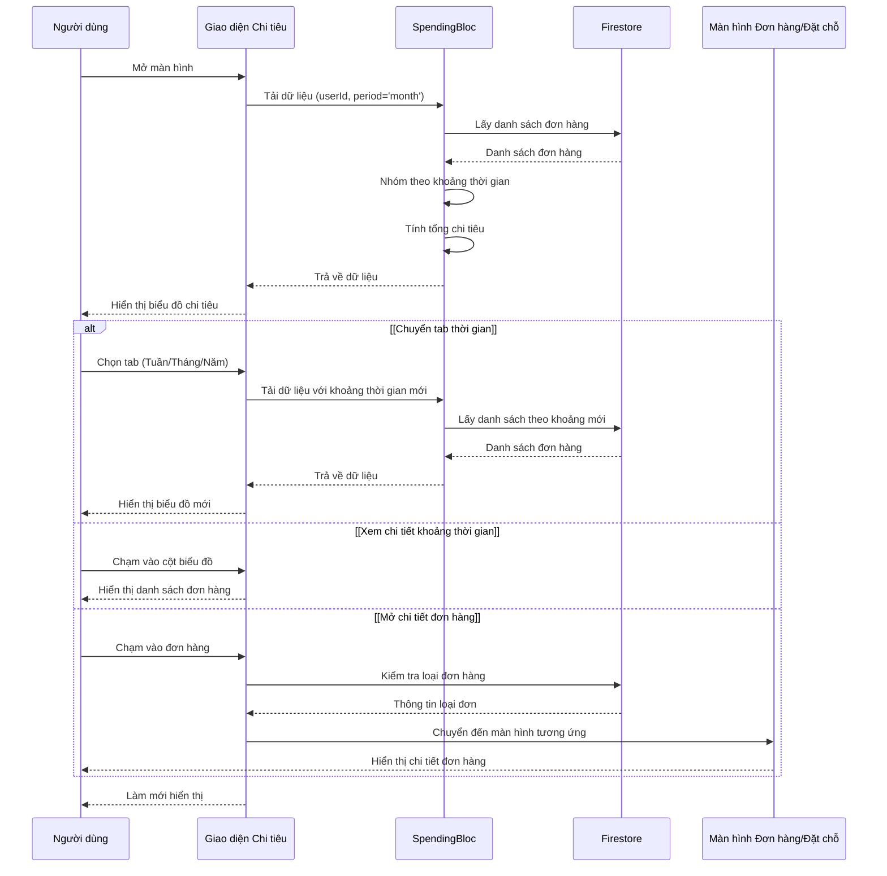
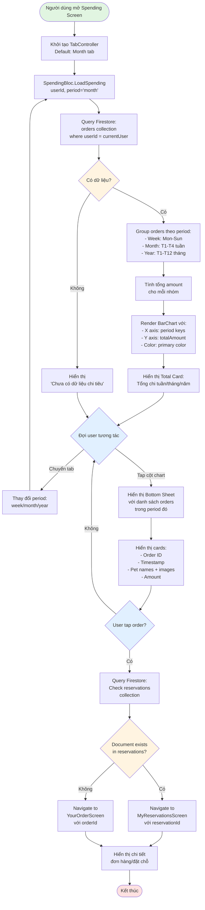
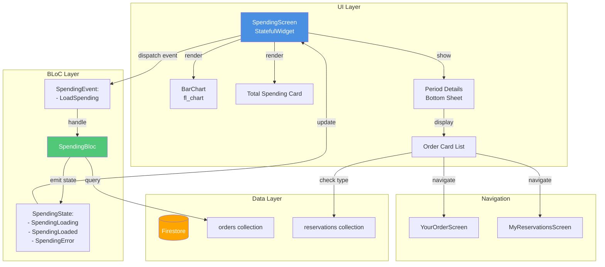
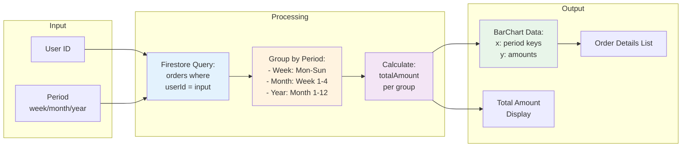
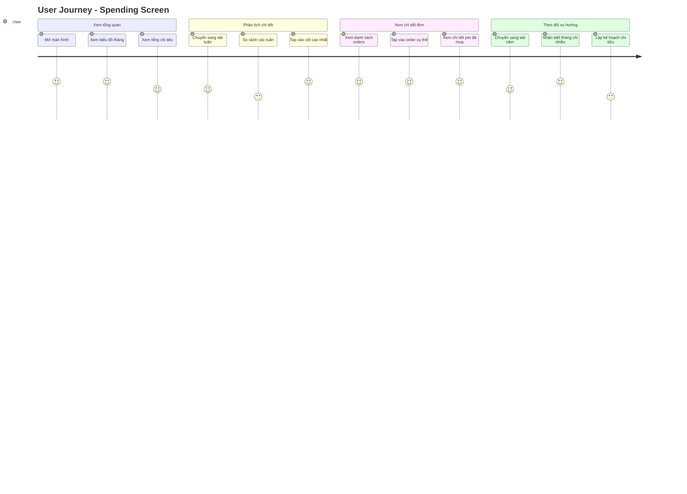

# Spending Screen - Sơ đồ hoạt động

## 1. 📋 Sơ đồ tuần tự (Sequence Diagram)



---

## 2. 🔄 Sơ đồ hoạt động (Activity Diagram)



---

## 3. 🏗️ Sơ đồ kiến trúc (Architecture Diagram)



---

## 4. 📊 Data Flow Diagram



---

## 5. 🔍 Chi tiết các thành phần

### **5.1. TabController Logic**
```dart
TabIndex 0 → period = 'week'
TabIndex 1 → period = 'month' (default)
TabIndex 2 → period = 'year'

_onTabChanged() → detect tab change → dispatch LoadSpending
```

### **5.2. Data Grouping Logic**
- **Week**: Group theo ngày trong tuần (Mon, Tue, Wed,...)
- **Month**: Group theo tuần trong tháng (T1, T2, T3, T4)
- **Year**: Group theo tháng trong năm (T1-T12)

### **5.3. Chart Touch Interaction**
```
FlTapUpEvent → get touchedBarGroupIndex 
→ find periodKey from sortedKeys[index]
→ call _showPeriodDetails(periodKey, data)
```

### **5.4. Order Type Detection**
```
Tap Order Card 
→ Query reservations/{orderId}
→ If exists: Navigate to MyReservationsScreen
→ Else: Navigate to YourOrderScreen
```

---

## 6. 🎯 User Journey



---

## 7. ⚡ Performance Considerations

### **Optimizations:**
1. **BLoC Caching**: State được giữ khi chuyển tab nếu period không đổi
2. **Lazy Loading**: Bottom sheet chỉ load khi user tap vào cột
3. **Image Caching**: NetworkImage tự cache pet images
4. **Query Optimization**: Index trên `userId` và `timestamp` trong Firestore

### **Potential Issues:**
1. **Large Dataset**: Nếu user có nhiều orders, chart có thể lag
2. **Network Latency**: Mỗi lần chuyển tab query lại Firestore
3. **Memory**: Giữ tất cả order data trong memory

---

## 8. 🔒 Security & Privacy

- **Data Access**: Chỉ query orders của chính user (userId filter)
- **No Sensitive Data**: Không lưu thông tin thanh toán trong chart
- **Firestore Rules**: Cần rule để chỉ user được xem orders của mình

---

## 9. 📱 UI/UX Features

### **Tính năng tốt:**
✅ Tab navigation rõ ràng (Week/Month/Year)  
✅ Total card nổi bật với icon và format currency  
✅ Interactive chart với tooltip  
✅ Bottom sheet mượt mà với DraggableScrollableSheet  
✅ Pet images trong order list  
✅ Auto-detect order vs reservation  

### **Có thể cải thiện:**
❓ Thêm filter theo status (Pending/Completed)  
❓ Export data to CSV/PDF  
❓ Compare với period trước  
❓ Notifications khi chi tiêu vượt ngưỡng  
❓ Spending goals/budgets  

---

## 10. 🧪 Test Scenarios

```gherkin
Feature: Spending Analytics

  Scenario: Xem chi tiêu theo tháng
    Given User đã đăng nhập
    When User mở Spending Screen
    Then Hiển thị tab "Theo tháng" active
    And Hiển thị biểu đồ 4 tuần
    And Hiển thị tổng chi tháng này

  Scenario: Chuyển sang xem theo năm
    Given User đang ở tab tháng
    When User tap vào tab "Theo năm"
    Then Hiển thị biểu đồ 12 tháng
    And Hiển thị tổng chi năm này

  Scenario: Xem chi tiết một khoảng thời gian
    Given Biểu đồ đang hiển thị
    When User tap vào cột "Tuần 2"
    Then Hiển thị bottom sheet
    And Liệt kê tất cả orders trong tuần 2
    And Hiển thị pet images và amounts

  Scenario: Mở chi tiết order
    Given Bottom sheet đang hiển thị orders
    When User tap vào một order card
    Then System check order type
    And Navigate đến YourOrderScreen hoặc MyReservationsScreen
```

---

## 📌 Tổng kết

Chức năng **Spending Screen** sử dụng:

1. **Sơ đồ tuần tự (Sequence)** → Mô tả tương tác giữa User, UI, BLoC, Firestore
2. **Sơ đồ hoạt động (Activity)** → Mô tả logic flow và decision points
3. **Sơ đồ kiến trúc** → Mô tả cấu trúc layers (UI, BLoC, Data)
4. **Data Flow** → Mô tả luồng dữ liệu từ input đến output

**Cả 4 sơ đồ đều cần thiết** để hiểu toàn diện chức năng này! 🎯
